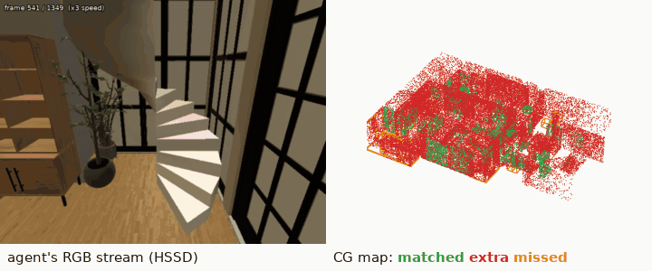
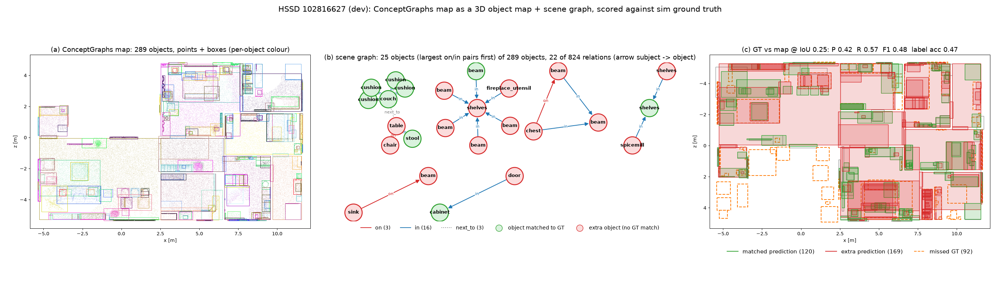
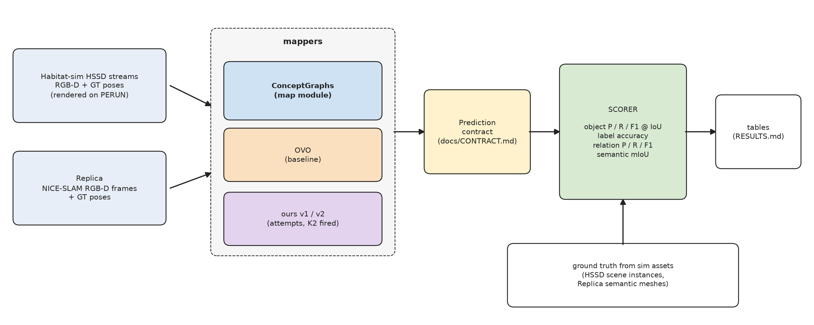
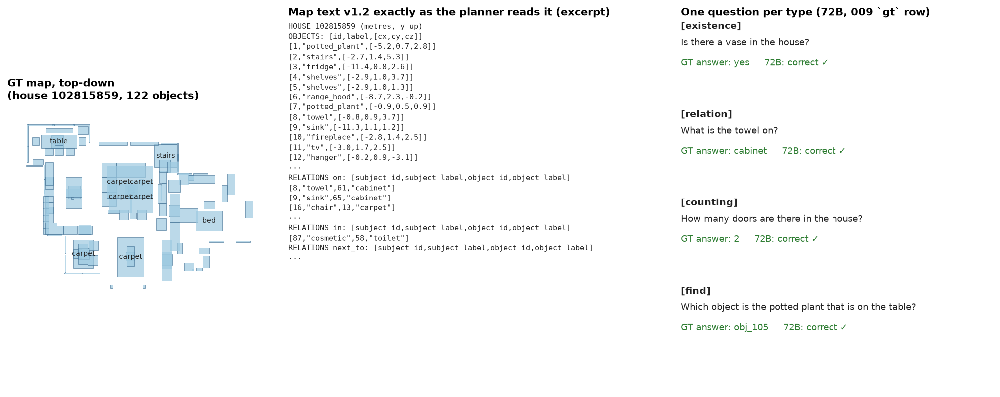
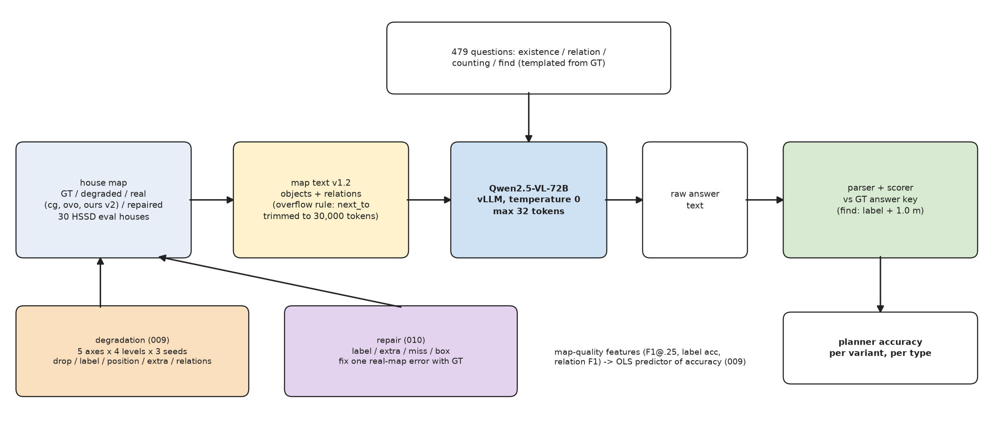
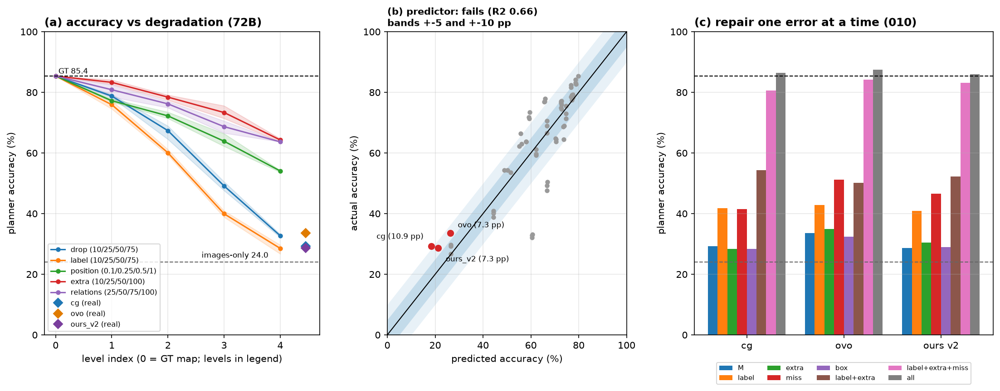
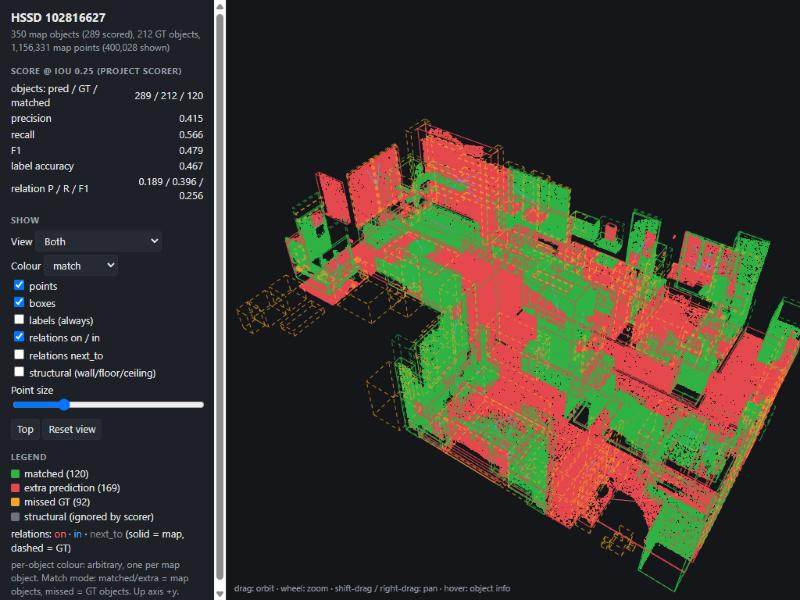

# Spatial memory: 3D object maps for a VLM planner

**Status: finished (2026-10-31), archived, read-only.** A research project. It is complete and no longer
maintained. Issues and pull requests are closed.


## Goal
Build a robot-style "spatial memory": from a camera walking through a house, make a map of every object
(what it is, where it is, how big) and of how the objects relate (on / in / next to). Then answer two
questions that real-world data cannot answer cleanly, because only a simulator knows the exact truth:

1. **Part 1 (P1a): how good is the map?** Score object maps exactly against the simulator's own ground truth,
   on simulated houses (HSSD in Habitat) and on the standard Replica benchmark next to published numbers.
2. **Part 2 (P1b): does a better map make a better planner?** Give the map, as text, to a vision-language
   model, ask it questions about the house, and measure how its success depends on map quality.

## Result in short
- **Maps:** a verified scorer (the true map scores a perfect 1.000; on the same OVO output it agrees with OVO's own
  evaluation code to within 0.75 mIoU, 26.75 vs 27.50). Both baselines reproduce their published Replica numbers to
  within 1 mIoU. ConceptGraphs is the map module: object F1@0.25 on 30 test houses is ConceptGraphs 0.406, OVO
  0.312, our own mapper 0.371. Our own mapper did not beat ConceptGraphs on Replica (14.65 vs 15.80 mIoU), so the
  pre-registered rule picked ConceptGraphs.
- **Planner:** with a perfect map Qwen2.5-VL-72B answers 85.4 % of 479 questions; with real maps 29–34 %;
  with 8 photos and no map 24.0 %.
- **Map scores do not predict planner success** on real maps (pre-registered test failed). Missed objects
  are the largest single error (for ConceptGraphs, missed objects and wrong labels tie), and errors compound.
- **Takeaway:** the planner is not the bottleneck. The camera has to see the whole house.

**Links:** [full results](RESULTS.md) · [demo video](media/114_demo.mp4) · [reproduce](#reproduce) ·
[limits](#limits-read-before-citing-a-number) · [licences](#licences-data-clean-room) ·
[deviations](DEVIATIONS.md)

**Author:** Matúš Filo, BSc student, Intelligent Systems, Technical University of Košice (FEI TUKE), 2026.
Compute: TUKE PERUN cluster (H200), 19.1 GPU-hours in total.



**Demo video (64 s):** [media/114_demo.mp4](media/114_demo.mp4) — the camera walking an HSSD house, its ConceptGraphs
map scored against GT, three planner questions, the headline numbers. (GitHub does not play repo mp4s inline: open
the link and use "View raw" / download.)



## Results (full tables: [RESULTS.md](RESULTS.md), generated from saved scores)

| | ConceptGraphs | OVO | ours v1 | ours v2 |
|---|---|---|---|---|
| HSSD eval 30: object F1 @ IoU 0.25 (pooled) | **0.406** | 0.312 | — | 0.371 |
| HSSD eval 30: label accuracy | 0.409 | **0.523** | — | 0.450 |
| Replica 8: mIoU, our re-run (published) | 15.80 (16.7) | **26.75** (27.0) | 13.03 | 14.65 |
| Replica 8: mIoU, the method's own eval code | — | 27.50 | — | — |
| Replica 8: mIoU of a perfect map (k=5 ceiling, same for all) | 99.6 | 99.6 | 99.6 | 99.6 |

- **ConceptGraphs** finds the right objects most often; **OVO** names them best.
- HOV-SG's published Replica mIoU is 22.5; we did not re-run it.
- k=5 ceiling: a perfect map scores 99.6 under the protocol's label transfer (ground-truth labels, k=5 neighbours).
- OVO's own eval code on its own output gives 27.50; our scorer gives 26.75 on the same output.

**Why ConceptGraphs is the map module.** We tried twice to beat ConceptGraphs on Replica with our own mapper:
- **v1:** SAM 2.1 + SigLIP 2.
- **v2:** CLIP ViT-H + per-view label voting, tuned only on 15 held-apart dev scenes.

Both came in below it (13.03 and 14.65 vs 15.80), so the kill rule we wrote before the first number fired. The rule
written before the second counted number then picked the map module: if K2 fires, the map module is the baseline with the
higher HSSD dev 5 F1@0.25 — ConceptGraphs 0.409 vs OVO 0.355. Checks show the shortfall is naming, not geometry: given the true labels, v2's own objects would score 53 mIoU.



## P1b — a planner over the map

**Question.** How much does a planner's success depend on the quality of the map it reads?

**Instrument** ([docs/P1B_PROTOCOL.md](docs/P1B_PROTOCOL.md), task 008):
- **Questions.** 479 templated questions on the 30 HSSD test houses (seed 114), with exact answers from GT. Four types:
  - "Is there a clock?" (existence);
  - "What is the teapot in?" (relation);
  - "How many toilets?" (counting);
  - "Which chair is next to the table?" (find).

  A rule program answers 100 %, which proves every answer key.
- **Map text.** The map goes to the planner as compact text: object id, label, centre; then on / in / next_to lines that
  carry both labels (format v1.2).
- **Planner.** Qwen2.5-VL-72B-Instruct with vLLM, temperature 0. The 7B model missed the pre-registered 70 % ceiling bar
  (62.8 %), so the pre-registered rule moved to 72B.



**Three findings** (full tables: [RESULTS.md](RESULTS.md)). Three of the readings were **pre-registered** (rule committed before the first number): (i) the planner ceiling /
escalation (008), (ii) the predictor reading (009), (iii) the repair dominant-error reading (010). The images-only
comparison and "errors compound" are **measured but not pre-registered**.
1. **The map is what makes the questions answerable.**
   - With the perfect (GT) map the planner gets **85.4 %**: existence 100, relation 84.0, counting 76.7, find 80.8.
   - With 8 photos and no map it gets **24.0 %** (find questions not asked to the images-only planner and scored wrong;
     359 asked).
   - With the real P1a maps it gets **29.2 %** (ConceptGraphs), **33.6 %** (OVO) and **28.6 %** (ours v2). That is barely
     more than no map.
2. **Map-quality scores do not predict this planner's success on real maps** (task 009, pre-registered reading **"fails"**:
   linear fit on object F1, label acc, relation F1; CG off by 10.9 vs the 10.0 bar; robustness subset partial).
   - We damaged the GT maps along 5 axes (drop objects, wrong labels, shifted positions, fake objects, missing
     relations; 4 levels × 3 seeds). Planner accuracy falls steadily on every axis.
   - A linear fit of accuracy on object F1 + label accuracy + relation F1, made on those 60 damaged maps + GT (61 points), misses the real maps:
     ConceptGraphs is off by 10.9 points (the pre-registered limit was 10), OVO and ours v2 by 7.3 each.
   - Object F1 (box overlap) carries no weight in the fit.
   - On the 15 houses that never needed prompt trimming the reading is "partial".
3. **What costs the planner on real maps is missed and mis-named objects, and the errors compound** (task 010).
   - We repaired one error type at a time against GT. Adding the missed objects is the dominant fix for OVO (+17.5
     points) and ours v2 (+18.0). ConceptGraphs has no single dominant error: labels +12.5 vs missed +12.3.
   - Fixing box shapes gains nothing.
   - No single fix recovers more than 18 of the 52–57 points lost, but labels + spurious + missed fixed together recover
     50.5–54.5.
   - With everything fixed, the planner is back at 86.0–87.5 %, which confirms the instrument.





**P1b limits:**
- **One planner** (Qwen2.5-VL-72B, Qwen licence: research use here).
- **Questions are templated:**
  - some phrasings are clumsy, e.g. "shelfs";
  - GT `in` is box containment, giving "the basket in the table".
- **Simulated houses only** (HSSD, CC BY-NC).
- **Coverage gaps.** The scripted camera paths under-visit some rooms, and that feeds the missed-object errors behind
  finding 3.
- **Long maps are trimmed** to fit the 32k context. The farthest `next_to` lines go first (rule in docs/P1B_SWEEP.md;
  deviation 17 adds a fallback that one house needed).
- **The find rule was tightened before 009:** the right label and within 1.0 m (deviation 16).
- **Relations are geometric.**
- **Pre-registrations and every deviation:** `docs/P1B_*.md` and [DEVIATIONS.md](DEVIATIONS.md) (rows 14–17).

## Reproduce

Everything heavy (Habitat rendering, ConceptGraphs, OVO, "ours" caches) ran on a SLURM cluster with H200 GPUs
(TUKE PERUN). The scorer, the tables, the figures and the demo run on a laptop (Windows 11, RTX 4060 8 GB, uv).

### Laptop
```bash
uv sync
uv run pytest -q                                   # unit tests

# Replica data + ground truth (~46 GB, resumable) — or, with the data already on disk, link its subfolders into
# data/ (data/ itself is tracked: it holds MANIFEST.md). PowerShell on Windows:
#   Get-ChildItem <existing data> -Directory | % { New-Item -ItemType Junction -Path "data\$($_.Name)" -Target $_.FullName }
# (Linux: for d in <existing data>/*/; do ln -s "$d" data/; done)
scripts/fetch_replica.sh all
uv run python -m spatialmem.gt.replica --all       # data/ -> gt/<scene>.json (objects, boxes, relations)
uv run python -m spatialmem.eval.selfcheck --all   # scorer self-check: GT scored as a prediction = 1.000 on every metric
uv run python -m spatialmem.render.proof           # rendered depth vs dataset depth (transform proof)

# tables + figures from the saved scores in results/scores/
uv run python -m spatialmem.report.results         # -> RESULTS.md (byte-identical on every run)
uv run python -m spatialmem.report.figs            # -> reports/figs/007_fig2/3, 011_p1b_fig2/3 (+ 011_p1b_fig1 with data/)

# P1b: question set + its proof, and the analyses from the saved planner results in results/p1b/
uv run python -m spatialmem.p1b.questions         # -> data/p1b/questions_v1.jsonl (sha256 in configs/p1b_v1.yaml)
uv run python -m spatialmem.p1b.solver            # rule solver on the GT maps: 100.0 % on every type
uv run python -m spatialmem.p1b.sweep             # 009 curves + predictor -> results/p1b/summary.json, reports/figs/009_*.png
uv run python -m spatialmem.p1b.repair_analysis   # 010 repair attribution -> results/p1b/repair.json, reports/figs/010_*.png

# demo: one HSSD house -> offline 3D map + scene-graph viewer (one HTML file)
uv run python -m spatialmem.demo --scene 102816627 # -> data/demo/102816627.html; open it in a browser

# demo video + README GIF from saved files (needs the house's RGB stream in data/hssd_streams/102815859/)
uv run --group media python scripts/make_demo_video.py   # -> media/114_demo.mp4, media/114_demo.gif
```

The demo reads ConceptGraphs' map and the HSSD ground truth from `data/`. In a fresh clone, point it at an existing
data folder with `SPATIALMEM_DATA=<path to data>`. The HTML embeds scene points, so it stays in the git-ignored `data/`.



### Re-scoring predictions
```bash
uv run python -m spatialmem.eval.score_baselines --methods cg ovo ours_v2 --out <dir>
```
- Reads `data/baselines/<method>/{replica,hssd,replica_dev}/<scene>.json`: the `Prediction` contract in
  [docs/CONTRACT.md](docs/CONTRACT.md), plus `.sem.npz` for Replica.
- Writes the score JSONs that `results/scores/` holds.

### Cluster (PERUN, apptainer + SLURM)
Set `PERUN_ACCOUNT` and `PROJECT_DIR` (and `LOGIN_NODE` for the upload scripts) for your own cluster. `#SBATCH`
lines are not shell-expanded, so replace `<PERUN_ACCOUNT>` and `<PROJECT_DIR>` in `hpc/**/*.sbatch` before submitting.

Images are built on the login node from `hpc/*.def`:
- `build_habitat.sh` (habitat-sim 0.3.3);
- `build_habitat_ptex.sh` (0.2.4, Replica textures);
- `build_cg.sh`, `build_ovo.sh`, `build_ours.sh`.

Code goes up with `hpc/push_snapshot.sh`, one copy per job, so running jobs never see an edit. Jobs:

| what | script |
|---|---|
| HSSD fetch + scene selection | `scripts/hssd_fetch.py` (login node) |
| HSSD streams | `hpc/slurm/job.sbatch <unit> -m spatialmem.hssd.run …` (runs inside `habitat.sif`) |
| Replica-dev renders | `hpc/slurm/replica_dev_render.sbatch` |
| ConceptGraphs | `hpc/slurm/cg_scenes.sbatch` |
| OVO | `hpc/slurm/ovo_job.sbatch` |
| ours | `hpc/slurm/ours_scenes.sbatch` / `ours_tasks.sbatch` |
| P1b planner (vLLM, Qwen2.5-VL; image `vllm.sif` from `vllm/vllm-openai:v0.10.1.1`) | `hpc/p1b/vllm_run.sbatch <model> <prompts> <out> <tp>` (+ `hpc/p1b/push_prompts.sh`) |

- Every job, its wall time and GPU-hours: [hpc/JOBS.md](hpc/JOBS.md). P1a used 15.3 H200-hours, P1b 3.8 (19.1 in total).
- Frozen configs: `configs/ours_v1.yaml` (c4af463), `configs/ours_v2.yaml` (8eed799). The tuning objective was committed
  before any tuning number: `configs/ours_v2_objective.md`.

## How scoring works
- **Objects:** Hungarian matching on 3D axis-aligned box IoU. A pair counts at IoU ≥ 0.25 (and 0.5). Label accuracy is
  measured over the matched pairs. Labels are mapped to one shared vocabulary (CONTRACT).
- **Relations:** `on` / `in` / `next_to` from fixed geometric rules ([docs/RELATIONS.md](docs/RELATIONS.md)), computed
  the same way for GT and predictions.
- **Replica semantic:** the OVO protocol exactly. Its metric code is vendored and executed as the reference. Point
  labels are transferred to the GT mesh with k=5 neighbours, and confusion is pooled over 8 scenes.
- **Instrument proof:** ground truth fed in as a prediction scores 1.000 on every metric (`selfcheck`). Contract and
  relation rules were frozen before any number; every later change is a dated entry.

## Limits (read before citing a number)
- **Coverage:** HSSD camera paths are scripted. Some rooms are barely visited: in dev house 102816627, a bathroom and
  a bedroom (21 of 212 objects) appear in 3 % of frames. This caps recall for every mapper equally.
- **Relations are geometric**, so the GT graph has no functional relations ("chair used with desk").
- **Replica-dev** (the 10 Replica scenes used only for tuning) is rendered in Habitat-sim 0.2.4 with PTex textures.
  Its frames look like the protocol's frames but are not the same renderer. Some views look into unscanned regions.
- **ConceptGraphs** ran with world-frame poses (`hpc/cg_patches/02_world_frame_poses.patch`), the same poses OVO and
  ours get. Its own default is first-frame-relative, and that can change its maps (15.80 here vs 16.7 published; frame, CG variant and label rule may all contribute).
- **OVO weights-predictor:** licence unstated by the authors — not redistributed here; we report evaluation numbers only, obtained with the authors' public release.
- **GT poses everywhere:** this measures mapping, not SLAM.

## Licences, data, clean-room
- Datasets are research / non-commercial: Replica Research Terms, HSSD CC BY-NC 4.0. They are **never committed or
  redistributed**: `data/` and the derived `gt/` are git-ignored.
- Every dataset, model and code source with its licence: [THIRD_PARTY.md](THIRD_PARTY.md). Checksums: `data/MANIFEST.md`.
- **Clean-room:** public code and public data only.
- This public snapshot holds code, saved scores and figures only. Not included: dataset files, model weights, Replica
  imagery or Replica-derived GT figures (Replica Research Terms forbid redistribution), and the project's internal
  working notes and per-step reports. Every pre-registered rule and deviation is in [DEVIATIONS.md](DEVIATIONS.md).
- HSSD-derived figures and the demo video are renders of HSSD scenes (`hssd/hssd-hab`), CC BY-NC 4.0: non-commercial
  use, with attribution.
- **License:** the code is MIT ([LICENSE](LICENSE)). `third_party/` keeps its own licences (OVO code, MIT). The
  HSSD-derived figures, the GIF, the demo video and the overview image are HSSD renders, CC BY-NC 4.0. Datasets are
  never redistributed.

## Layout
```
spatialmem/
├── gt/        ground truth from sim/dataset assets (Replica semantic meshes; HSSD via hssd/)
├── hssd/      HSSD scene GT + vocabulary
├── eval/      scorer (objects, relations, semantic) + the Prediction contract + selfchecks
├── render/    mesh raycaster + render proof
├── baselines/ ConceptGraphs / OVO prediction converters
├── ours/      ours v1 / v2 mapper (attempts)
├── report/    RESULTS.md + figures from saved scores
├── p1b/       questions, map text, prompts, parser / scorer, degradations (009), repairs (010), analyses
└── demo.py    offline HTML map + scene-graph viewer
```
Kill criterion K2, pre-registered rulings and the deviation log: [DEVIATIONS.md](DEVIATIONS.md).
